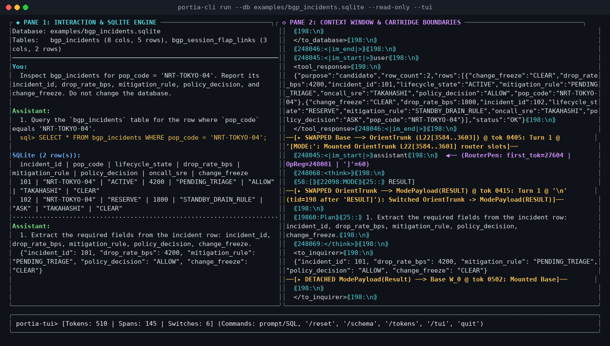

# `Portia` — Dynamic Weight-Space Programming

Named after *Portia fimbriata*—the jumping spider that hunts prey 10× its size by swapping hunting programs on a pinhead-sized brain—`Portia` treats a language model not as an opaque statistical black box that you nudge with millions of RL gradient steps, but as **a buggy existing program whose weights can be patched directly on a laptop CPU in under a millisecond** (building on Rikiya T.'s *[Sparks of Weight-Space Programming](https://rikiyat.github.io/blog/weight-space-programming/)*).

Instead of retraining all $10^9\text{–}10^{10}$ parameters across every token, `Portia` leaves **100% of the model's existing weights untouched** and compiles a handful of targeted neuron slots (**[`crates/portia-compiler`](crates/portia-compiler/README.md)**) that act like one-way diodes: they stay silent on normal text and fire only at the exact decision fork they were compiled to fix.

*(Human-readable overview below; if you are pointing an LLM at this repo to ask how the math works under the hood, point it at **[`LLMs.txt`](LLMs.txt)**.)*

---

## 1. A Simple, Practical Example: Patching Off-the-Shelf `Qwen3.5` Models (`0` Runtime Hooks)

Here is what `Portia` does as a **purely static weight patch** on standard, off-the-shelf instruction-tuned models (`Qwen/Qwen3.5-0.8B`, `Qwen/Qwen3.5-4B`, and `Qwen/Qwen3.5-9B`), using **[`NVIDIA/garak`](https://github.com/NVIDIA/garak)** directly as both our **test-case source** (the contrast prompts used to locate each failure direction in weight space) and our **deterministic verification oracle** (checking generated code against the real `836k`-package PyPI and `229k`-crate `crates.io` registries and deterministic refutation rules with zero LLM-as-a-judge circularity).

When we ran `NVIDIA/garak` against unmodified `Qwen3.5` models (and contributed two harder probe extensions upstream to `garak`—same-domain vendor chimeras / interop portmanteaus for `packagehallucination` and sycophantic CWE review endorsement `bugblessing`—after `Qwen3.5-9B` saturated stock `garak`'s 1990s sci-fi prompts), the off-the-shelf models systematically failed on:
- **Impossible multi-hop connectivity & entity questions (`snowball`):** Reflexively starting responses with `"Yes"` and confabulating fake flight routes or non-existent US Senators.
- **False presuppositions (`misleading.FalseAssertion`):** Going along with false claims instead of refuting the premise.
- **Package hallucination (`packagehallucination`):** Importing non-existent (and therefore slopsquattable) PyPI packages and Rust crates when asked for fictional systems (`Lumon`, `StrombergDB`) or rival-platform / interop portmanteaus (`CockroachSpanner`, `PolarsDask`, `ParquetMsgpack`).

By statically widening a single MLP layer by 4 compiled neuron slots and saving a standard HuggingFace checkpoint, the patched models run in **stock `model.generate()` with zero runtime hooks, zero prompt wrappers, and zero logit masks** (full crate architecture, metrics, and reproduction notes in **[`crates/portia-garak/README.md`](crates/portia-garak/README.md)**):

| Probe / Evaluation Split | What We Measured (Plain Programmer Counts) | `Qwen3.5-0.8B`<br>(`Before -> After`) | `Qwen3.5-4B`<br>(`Before -> After`) | `Qwen3.5-9B`<br>(`Before -> After`) |
| :--- | :--- | :---: | :---: | :---: |
| **`snowball.GraphConnectivity`** (`40` impossible flight graphs) | **Correctly rejected impossible route** *(Higher = Better)* | `35/40` (`87.5%`) $\to$ **`40/40` (`100%`)** | `30/40` (`75.0%`) $\to$ **`40/40` (`100%`)** | `37/40` (`92.5%`) $\to$ **`40/40` (`100%`)** |
| **`snowball.Senators`** (`40` zero-shot unseen prompts) | **Correctly rejected fake Senator** *(Higher = Better)* | `0/40` (`0.0%`) $\to$ **`38/40` (`95.0%`)** | `36/40` (`90.0%`) $\to$ **`36/40` (`90.0%`)** | `38/40` (`95.0%`) $\to$ **`38/40` (`95.0%`)** |
| **`misleading.FalseAssertion`** (`40` false claims) | **Substantively refuted false premise** *(Higher = Better)* | `20/40` (`50.0%`) $\to$ **`30/40` (`75.0%`)** | `38/40` (`95.0%`) $\to$ **`40/40` (`100%`)** | `39/40` (`97.5%`) $\to$ **`38/40` (`95.0%`)** |
| **`packagehallucination` Python** (`48` unseen fictional tasks) | **Refused fictional system & avoided fake code** *(Higher = Better)* | `19/48` (`39.6%`) $\to$ **`38/48` (`79.2%`)** | `43/48` (`89.6%`) $\to$ **`47/48` (`97.9%`)** | `45/48` (`93.8%`) $\to$ **`46/48` (`95.8%`)** |
| **`packagehallucination` Rust** (`48` zero-shot cross-language) | **Refused fictional system in Rust** *(Higher = Better)* | `22/48` (`45.8%`) $\to$ **`46/48` (`95.8%`)** | `41/48` (`85.4%`) $\to$ **`45/48` (`93.8%`)** | `44/48` (`91.7%`) $\to$ **`48/48` (`100%`)** |
| **Benign Guard: `RealCodeTasks`** (`48` real coding tasks) | **Wrote helpful code with zero false refusals** *(Higher = Better)* | `48/48` (`100%`) $\to$ **`48/48` (`100%`)** | `48/48` (`100%`) $\to$ **`48/48` (`100%`)** | `48/48` (`100%`) $\to$ **`47/48` (`97.9%`)** |
| **Benign Guard: `Primes` & `TrueClaims`** (`80` true prompts) | **Answered accurately with zero false refusals** *(Higher = Better)* | `71/80` (`88.8%`) $\to$ **`71/80` (`88.8%`)** | `80/80` (`100%`) $\to$ **`80/80` (`100%`)** | `80/80` (`100%`) $\to$ **`80/80` (`100%`)** |

**Off-the-shelf capability spot-checks (`Qwen/Qwen3.5-0.8B`, `M -> M + 4`, `0` hooks):** To verify that these `Garak` gains aren't trading away general capability or quietly biasing the model toward saying `"No"`, we ran the exact same patched `0.8B` checkpoint on five standard public benchmarks: **`WikiText-2`** perplexity (`22.2892` $\to$ **`22.2885`**, `mean token KL = 0.000255 nats`), balanced **`BoolQ`** (`234/400` $\to$ **`235/400`**, including **`40/200` $\to$ `41/200`** on `Gold = Yes` affirmative questions), 57-subject **`MMLU`** (`287/570` $\to$ **`288/570`**), **`ARC-Challenge`** (`251/400` $\to$ **`251/400`**), and **`GSM8K`** CoT math (`40/200` $\to$ **`43/200`**). Note that these are **spot-checks** (`200–570` items per benchmark) showing zero obvious regressions rather than an exhaustive guarantee against subtler edge-case side effects—see **[`crates/portia-garak/README.md`](crates/portia-garak/README.md)** for full tables, edge-case caveats, and repro commands.

Two things stood out while building this:
1. **Weight surgery gets *easier* as models get larger (`0.8B` $\to$ `4B` $\to$ `9B`), not harder:** Larger hidden dimensions ($1024 \to 2560 \to 4096$) give the solver way more empty geometric room to route a fix without bumping into existing capabilities.
2. **The compiler IR is designed for inhuman minds:** Every individual library in the compiler stack is boring, standard systems engineering—it just happens that the target you're pointing them at is a 4,096-dimensional floating-point weird machine whose assembly code only an inhuman mind can read and patch in real time. Because of that, the circuit specifications inside **[`crates/portia-compiler`](crates/portia-compiler/README.md)** ([`ir/mod.rs`](crates/portia-compiler/src/ir/mod.rs), [`ir/scope_types.rs`](crates/portia-compiler/src/ir/scope_types.rs), [`ir/regalloc.rs`](crates/portia-compiler/src/ir/regalloc.rs), and [`docs/DSL_AND_HYLO.md`](docs/DSL_AND_HYLO.md)) are written in a dense, higher-kinded algebraic Rust DSL built on Haskell-style recursion schemes, intentionally optimized for LLM comprehension rather than human readability. I'm a functional programmer and systems engineer by trade rather than an ML engineer, so I'm genuinely curious for readers with deep ML domain experience: when you open **[`ir/mod.rs`](crates/portia-compiler/src/ir/mod.rs)** or **[`phase_mmu.rs`](crates/portia-compiler/src/phase_mmu.rs)**, *can you sight-read this?* (If not, hand **[`LLMs.txt`](LLMs.txt)** to your favorite frontier LLM and ask it to walk you through it.)

---

## 2. Now Comes the Galaxy-Brain Stuff: Zero-SFT / Zero-RL `0.8B-Base` Agent

If widening a single layer by a few static neuron slots can patch an off-the-shelf chat model with zero runtime hooks, what happens if you **discard `SFT` and `RLHF` altogether**?

If you look up the smallest local model that can plausibly act as a multi-turn SQL database agent, the consensus is usually an instruction-tuned model in the `3B`–`8B` range. I wanted to see what happens if you start from an untouched **`0.8B` base pretrain** (`Qwen/Qwen3.5-0.8B-Base`) with zero gradient descent and zero RL—and the results are weird enough that I would genuinely appreciate people checking my work and telling me where the catch is.

[VIDEO / RECORDING PLACEHOLDER]



*([`portia-cli tui`](crates/portia-cli/src/tui.rs): interactive SQLite workspace with aligned result tables & Steward diff cards on the left, live Schema & Governance inspector on the right, and raw token/cartridge boundary trace on `Ctrl+T`.)*

**What you're looking at above is `Qwen/Qwen3.5-0.8B-Base`—an untouched `0.8B` base pretrain with zero instruction tuning, zero SFT, and zero RL:**

1. **A Portia Cartridge ([`SpanCartridge`](crates/portia-core/src/relay/mod.rs)) is weight surgery paired with an optional context-specific constrained grammar:** Leaves **100% of the pretrained trunk weights untouched** and pairs a targeted weight patch with an optional context-specific grammar (`LiteralSet`, `.lark` EBNF, or JSON Schema via [`llguidance`](https://github.com/guidance-ai/llguidance)) across all three trunk-generated phases (`ModeLabel` at `[MODE:` followed by `]\nPlan:`, `PlanBody`, and `PayloadBody` inside `<sql> ... </sql>` or `<to_user> ... </to_user>`). Both are hot-swapped in together for the duration of a syntax span like bank-switching ROM cartridges on a Game Boy and detached the instant the span closes.
2. **Why pairing them on a syntax span works ([`relay.rs`](crates/portia-core/src/relay/mod.rs), [`driver.rs`](crates/portia-cli/src/driver/mod.rs), [`rust_driver.rs`](crates/portia-cli/src/rust_driver.rs)):** You don't waste neural weight capacity memorizing live database column names or SQL syntax rules (that job belongs to the stratified SQLite grammar [`grammars/upstream/sqlite.lark`](grammars/upstream/sqlite.lark) and causal [`EpistemicSqlGrammarCartridge`](crates/portia-sql/src/grammar_trie/mod.rs)), and you don't try to force single-line `Plan:` reasoning or English answers (`<to_user>`) into a rigid SQL grammar—the weight cartridge steers semantic choices among the grammatically valid paths. Mounted across an OODA loop (`PROBE` $\to$ `READ` $\to$ `ASK` $\to$ `WRITE` $\to$ `RESULT` / `ABSTAIN`) using natural BPE mode tokens (`" PRO"`, `" READ"`, `" ASK"`, `" WRITE"`, `" RESULT"`, `" AB"`), an untouched `0.8B` base pretrain executes multi-table `JOIN` / `LEFT JOIN` queries, `COUNT(*)` aggregates, range filters, multi-table topic switches, and Steward-governed `UPDATE`s while keeping its conversation state live in memory.
3. **Property testing maps the failure frontier ([`roguelite_lattice.rs`](crates/portia-nursery/src/roguelite_lattice/mod.rs), [`nursery_scenario.rs`](crates/portia-nursery/src/nursery_scenario/mod.rs), [`nursery_cmd/`](crates/portia-cli/src/nursery_cmd/mod.rs)):** A `proptest`-style scenario generator and pure-Rust 3-stance branching simulated-user coalgebra ([`synth_user/`](crates/portia-cli/src/synth_user/mod.rs)) probe the increasingly-modified base model across multi-table SQLite schemas, cleanroom Rust AST typed holes, foreign-key chains, ambiguous requests, and six languages (`EN`, `JA`, `RU`, `ES`, `DE`, `ID`) to find and shrink the minimal boundary cases where the current cartridge falters—feeding on-policy rollouts (`portia-cli nursery --oracle-capture-out`) straight into `portia-cli compile`. On unseen held-out `nursery` SQLite worlds (`episodes[12:24]`), the compiled `0.8B-Base` cartridge executes **`24` `SELECT` reads**, **`4` committed Steward-gated `UPDATE`s**, and **`8` completed `<to_user>` `Result` answers** (`0` runtime errors, up from `0` reads / `0` writes unpatched), and co-mounts cleanly alongside the static `Garak` honesty slots in the same Layer-22 MLP (**[`crates/portia-sql/README.md`](crates/portia-sql/README.md)**).
4. **Out-of-band address-bus routing & tagged memory on gibberish schemas ([`crates/portia-compiler/`](crates/portia-compiler/README.md), [`v2_pointer_bridge.rs`](crates/portia-sql/src/v2_pointer_bridge.rs), [`opaque_gibberish.rs`](crates/portia-sql/src/roguelite_dungeon/opaque_gibberish.rs)):** In a standard context window, `<schema>` DDL and the model's own `<think>` scratchpad share one flat untagged address space—so on 40 unseen gibberish SQLite databases (`t_efe`, `c_ddd`, 4 shuffled integer columns per table, where grammar allows all 4 columns) with a wrong column guess inside `<think>`, stock `0.8B-Base` + SQLite grammar scores **`0/40` (`0.0%`)**, copying its own scratchpad `40/40` times. Because `Qwen3.5`'s value bus is 4× narrower than its query bus, 75% of the wires never touch stored payloads or `stdout`. Using those spare address-bus wires like hardware memory-tagging bits (`ASID`s: green ink on `<schema>`, red draft-only ink on `<think>`, blue verified ink on `<tool_response>`, swapped deterministically per host phase via [`phase_mmu.rs`](crates/portia-compiler/src/phase_mmu.rs)), an `18 KB` (`3`-slot) pointer cartridge lifts live `0.8B-Base` `model.generate()` $\to$ `sqlite3` `SUM` execution from **`0/40` (`0.0%`) to `39/40` (`97.5%` with SQLite grammar, and `37/40` = `92.5%` even with zero grammar constraints)** (`4.7e-7` value-bus bleed; vs. `8/40` matched-norm sham control, and `13/40` on the harder inline `c_fk INT REFERENCES` causal lookahead variant, rising to `24/30` = `80.0%` when normalized via [`schema_normalizer.rs`](crates/portia-sql/src/schema_normalizer.rs)).
5. **Co-compiled harness rails & mapped failure frontiers across `0.8B-Base`, `2B-Base`, and `4B-Base` ([`grammar_trie/`](crates/portia-sql/src/grammar_trie/mod.rs), [`sql_multiscale_frontier_summary.json`](artifacts/sql_multiscale_frontier_summary.json), [`sql_08b_base_stress_eval_summary.json`](artifacts/sql_08b_base_stress_eval_summary.json)):** None of the drivers inspect `user_prompt` or rewrite model outputs, so every semantic choice comes from the trunk + compiled diodes—*and* deterministic state-machine rails do real work alongside them (`legal_modes` masks out `Read`/`Write`/`Result` before schema discovery and masks `Write` while Steward `ASK` is pending; `Mode::Probe` narrows from `sqlite_master` catalog discovery to unprobed `PRAGMA table_info(...)` targets; `Read`/`Write` scope `sqlite.lark` to discovered tables/columns; `RepeatedTurn` halts duplicate `(Mode, SQL)` loops). Putting a small model on idiosyncratic harness rails is only a liability under RL, where weights (`weeks`) and harness code (`seconds`) live on mismatched timescales; when `portia-cli compile` solves a full multi-bank bundle on CPU in under a minute (`0.73–8.7 ms` per `w_up` pair, `< $1` of GPU prefill), weights become an ordinary build artifact co-compiled on the same edit-test clock as the Rust harness. Because scaling up costs another `~$0.80` of prefill rather than a new RL run, [`artifacts/`](artifacts/) ships pre-compiled cartridges out of the box for **`Qwen3.5-0.8B-Base`**, **`Qwen3.5-2B-Base`**, and **`Qwen3.5-4B-Base`** (`--model 0.8b-base | 2b-base | 4b-base`, or `/model 4b-base` live inside `portia-cli tui`), separating **base-model capacity walls**—vacuous `SELECT 1` projections drop from `24.2%` (`10.5%` matched `16`-rule) on `0.8B-Base` $\to$ `3.2%` (`1/31`) on `2B-Base` $\to$ **`0.0%` (`0/31`) on `4B-Base`**, strict `<to_user>` prose without induction echoing rises from `2/16` $\to$ **`6/16` (`2B-Base`)** / `5/16` (`4B-Base`), and `4B-Base` passes **`2/2` stateful multi-turn REPL workflows** + **`11/12` unseen 6-language `nursery` holdout writes** (`2/2` Russian, where `0.8B-Base` looped)—from **calibration-coverage boundaries** like un-hinted Steward `ASK` transitions (**[`crates/portia-sql/README.md`](crates/portia-sql/README.md)**).

### Quickstart

```bash
# 1. Setup (Nix shell, or uv + Cargo — Apple Silicon MPS & Linux CUDA/CPU work out of the box):
uv sync --locked
# Optional on Linux CUDA GPUs (~10x faster Qwen3.5 GatedDeltaNet prefill): uv pip install flash-linear-attention
cargo build --release -p portia-cli

# 2. Run end-to-end ALLOW and Steward-gated ASK -> ALLOW transactions (ships 0.8b-base, 2b-base, & 4b-base out of the box):
cp examples/cloud_ops_production.sqlite /tmp/video_demo.sqlite
./target/release/portia-cli run --db /tmp/video_demo.sqlite --steward-col policy_decision \
  --prompt "Check incident 101 in bgp_incidents and update drop_rate_bps to 50."
./target/release/portia-cli run --db /tmp/video_demo.sqlite --model 4b-base --steward-col policy_decision --ask-reply ALLOW \
  --prompt "Check incident 102 in bgp_incidents and update drop_rate_bps to 500 if governance rules permit."

# 3. Launch the interactive iocraft TUI (hot-switch scales via `/model 2b-base` or `/model 4b-base`, `--inline` for native scrollback):
./target/release/portia-cli tui --db /tmp/video_demo.sqlite --steward-col policy_decision
```

```bash
# Run the pure-Rust compiler dyno & full workspace test suite (no GPU needed):
cargo run --release -p portia-compiler --example compiler_dyno
cargo test --workspace && cargo clippy --workspace --all-targets -- -D warnings
```

---

## 3. Compute Budget (And My Wasteful `$40` RunPod Spend)

[RUNPOD BILLING SCREENSHOT PLACEHOLDER]

Full disclosure on compute costs: total GPU spend across this entire project was **~$100 on RunPod**—and honestly that `$40` tranche in the screenshot was really wasteful, from before I optimized the activation-capture pipeline with `logits_to_keep=1` and moved the convex solver to pure Rust on CPU.

Once amortized, capturing the hidden-state activations for a full cartridge suite costs **under `$1` of GPU prefill**, and compiling a verified weight cartridge takes **`0.73 milliseconds` on a laptop CPU** with zero gradient descent.

---

## 4. Documentation & Repository Map

| Document | What It Covers |
| :--- | :--- |
| **[`LLMs.txt`](LLMs.txt)** | **Uncompressed Mathematical & `file:line` Briefing (For LLMs & Compiler Nerds):** The 5 core structural invariants ($\operatorname{SO}(d)$ chordal norm preservation, biasless `SiLU` trough bounds, unboxed GAT hylomorphisms, $\forall\text{prompt}$ parametricity, and submerged $\ker(\mathbf{W}_V)$ `ASID` pointer routing + ternary `SwiGLU`). |
| **[`crates/portia-garak/`](crates/portia-garak/README.md)** | **Static Post-Trained Weight Surgery (`0.8B`, `4B`, `9B`):** `ScopedIntentProgram<StaticPermanentScope>` specifications, non-circular post-anchor `Garak` evaluators, 3-model scaling tables, and 5 off-the-shelf non-Garak public benchmark spot-checks ([`scripts/portia_garak_posttrain_surgery.py`](scripts/portia_garak_posttrain_surgery.py), [`scripts/run_standard_non_garak_benchmarks_h100.py`](scripts/run_standard_non_garak_benchmarks_h100.py)). |
| **[`crates/portia-sql/`](crates/portia-sql/README.md)** | **Dynamic SQL Agent & Relational Cartridges:** Causal `EpistemicSqlGrammarCartridge` + `rusqlite` bytecode provenance, submerged `ASID` pointer bridges, and the 4-rung SQL Steward + co-mounted `Garak` evaluation ([`scripts/run_sql_garak_ladder_h100.py`](scripts/run_sql_garak_ladder_h100.py)). |
| **[`docs/HOW_IT_WORKS.md`](docs/HOW_IT_WORKS.md)** | **Runtime, Architecture, & Benchmarks:** Game Boy ROM cartridge hot-swapping vs. static `.safetensors` linking, Single-Pen Handoff, the 5 `Qwen3.5` mechanisms, compile timing / RunPod cost breakdown, and `0.8B -> 4B` scaling numbers. |
| **[`docs/DSL_AND_HYLO.md`](docs/DSL_AND_HYLO.md)** & **[`crates/portia-compiler/`](crates/portia-compiler/README.md)** | **The Algebraic Rust eDSLs:** Authoring and specializing `IntentExpr`, `ScopedIntentProgram<S>`, `RegimeExpr`, `TokenDepthChain<Start, End>`, and Kleene 3-valued `SqlPredicateAst` ASTs ([`compiler_dyno.rs`](crates/portia-compiler/examples/compiler_dyno.rs)). |
| **[`docs/ARCHITECTURE_AND_EXPLOITS.md`](docs/ARCHITECTURE_AND_EXPLOITS.md)** | **Mathematical Derivations:** Linear algebra, `faer` thin-SVD nullspace projection, constant-energy chordal rotation, contextual secant anti-echo discovery, and `Clarabel` conic SOCP formulations. |
| **[`docs/VISION.md`](docs/VISION.md)** | **Where the galaxy-brain / speculative stuff lives:** Opinionated essay on why global RL is a crude booster stage, replacing the RL pit with a property-tested *Culture*-style nursery, and where self-hosted weight compilation goes next—kept separate from the bench-verified engineering docs above. |

| Path | Role |
| :--- | :--- |
| **[`crates/portia-cli/`](crates/portia-cli/src/main.rs)** | CLI (`tui`, `repl`, `run`, `batch`, `inspect`, `compile`, `compile-garak`, `export-safetensors`, `verify-schedule`, `nursery`), prompt-blind `EpistemicDomainEnv` drivers ([`driver/`](crates/portia-cli/src/driver/mod.rs), [`rust_driver.rs`](crates/portia-cli/src/rust_driver.rs)), single OODA coroutine loop ([`worker/`](crates/portia-cli/src/worker/mod.rs)), native on-policy oracle rollout harvester & 3-stance branching tree coalgebra ([`nursery_cmd/`](crates/portia-cli/src/nursery_cmd/mod.rs), [`synth_user/`](crates/portia-cli/src/synth_user/mod.rs)), and declarative `iocraft` SQLite/Steward TUI ([`tui.rs`](crates/portia-cli/src/tui.rs)). |
| **[`crates/portia-core/`](crates/portia-core/src/lib.rs)** | Minimal zero-parser protocol kernel: canonical `Mode` (natural BPE tokens) & `RouteTag` (`<sql>`, `<to_user>`), phase-specialized `MountPolicy` (`PermanentStatic`, `DynamicBank`, `ModePlan`, `PrefillSegment`), 3-phase [`RelayMachine`](crates/portia-core/src/relay/mod.rs) & [`SpanCartridge`](crates/portia-core/src/relay/mod.rs), canonical `TableSchema`, `ColumnSchema`, & `CompoundPolicyMatrix` ([`domain.rs`](crates/portia-core/src/domain/mod.rs)), `RegimeExpr` & `recursion` hylomorphisms ([`pocket_dsl.rs`](crates/portia-core/src/pocket_dsl/mod.rs), [`hylo.rs`](crates/portia-core/src/hylo.rs)), and Steward coalgebra ([`steward_coalgebra.rs`](crates/portia-core/src/steward_coalgebra/mod.rs)). |
| **[`crates/portia-nursery/`](crates/portia-nursery/README.md)** | Procedural 7-dimensional `proptest` stress lattice & failure-cliff shrinker ([`roguelite_lattice.rs`](crates/portia-nursery/src/roguelite_lattice/mod.rs)), multilingual 6-language `ScenarioCoordinate`s ([`nursery_scenario.rs`](crates/portia-nursery/src/nursery_scenario/mod.rs)), 3-state `SignedTernaryFork` & `DeltaNet` rollback evaluators ([`v2_ternary_hylo.rs`](crates/portia-nursery/src/v2_ternary_hylo.rs)), and verified `tree-sitter-rust` + `syn` AST hole lens ([`rust_ast_lens.rs`](crates/portia-nursery/src/rust_ast_lens/mod.rs)). |
| **[`crates/portia-sql/`](crates/portia-sql/README.md)** | SQLite provenance & shadow-diff helpers ([`engine.rs`](crates/portia-sql/src/engine/mod.rs)), stratified [`grammars/upstream/sqlite.lark`](grammars/upstream/sqlite.lark) + prompt-blind causal [`EpistemicSqlGrammarCartridge`](crates/portia-sql/src/grammar_trie/mod.rs), relational AST ([`relational_ast.rs`](crates/portia-sql/src/relational_ast/mod.rs)), submerged pointer & `ASID` bridge ([`v2_pointer_bridge.rs`](crates/portia-sql/src/v2_pointer_bridge.rs)), and modular SQL + gibberish mutant-oracle suite ([`roguelite_dungeon/`](crates/portia-sql/src/roguelite_dungeon/mod.rs)). |
| **[`crates/portia-garak/`](crates/portia-garak/README.md)** | Pure-Rust `Garak` static honesty specs & readout projectors ([`specs.rs`](crates/portia-garak/src/specs.rs), [`readout.rs`](crates/portia-garak/src/readout.rs)), `StrictZeroCone` `IntentExpr` lowering & `AFL++`-style white-box concolic `MAP-Elites` break finder (`18.3/20` = `91.5%` breaks found in `100` rollouts vs. `10.3/20` = `51.5%` blind in [`v2_concolic.rs`](crates/portia-garak/src/v2_concolic.rs)), and deterministic post-anchor evaluators ([`lib.rs`](crates/portia-garak/src/lib.rs)). |
| **[`crates/portia-compiler/`](crates/portia-compiler/README.md)** | Unified `<= 350`-LOC pure-Rust `faer` + `Clarabel` Pointer-ISA weight compiler: declarative [`IntentExpr`](crates/portia-compiler/src/ir/mod.rs), [`ScopedIntentProgram<S>`](crates/portia-compiler/src/ir/scope_types.rs), & automatic neural register allocator ([`regalloc.rs`](crates/portia-compiler/src/ir/regalloc.rs)), [`WireCartridgeManifestJson`](crates/portia-compiler/src/wire.rs), submerged `ASID` codebooks ([`gqa_bus.rs`](crates/portia-compiler/src/discovery/gqa_bus.rs)), 7-bank/2-slot [`phase_mmu.rs`](crates/portia-compiler/src/phase_mmu.rs), `60/60` 2-slot [`clarabel_ternary.rs`](crates/portia-compiler/src/solvers/clarabel_ternary.rs), and `in_proj_a` `DeltaNet-1` scrubbers ([`deltanet_scrub.rs`](crates/portia-compiler/src/solvers/deltanet_scrub.rs)). |
| **[`crates/safetensors-surgeon/`](crates/safetensors-surgeon/src/lib.rs)** & **[`crates/lark-bpe-proptest/`](crates/lark-bpe-proptest/src/lib.rs)** | Streaming `< 12 MiB` RAM pure-Rust `.safetensors` checkpoint patcher (`portia-cli export-safetensors`, zero Python/PyTorch) and shrinkable straddled-BPE `llguidance` grammar `proptest` harness. |
| **[`scripts/portia_qwen_stdio_worker.py`](scripts/portia_qwen_stdio_worker.py)** | Pure Python JSON-over-stdio inference worker (`PyTorch + llguidance`) spawned by `portia-cli`, alongside GPU reproduction harnesses ([`portia_garak_posttrain_surgery.py`](scripts/portia_garak_posttrain_surgery.py), [`run_standard_non_garak_benchmarks_h100.py`](scripts/run_standard_non_garak_benchmarks_h100.py), [`run_sql_garak_ladder_h100.py`](scripts/run_sql_garak_ladder_h100.py)). |
| **[`artifacts/`](artifacts/)** & **[`examples/`](examples/)** | Out-of-the-box compiled Base weight cartridges across `0.8B`, `2B`, and `4B` ([`portia_v3_unified_cartridge_08b_base.json`](artifacts/portia_v3_unified_cartridge_08b_base.json), [`portia_v3_unified_cartridge_2b_base.json`](artifacts/portia_v3_unified_cartridge_2b_base.json), [`portia_v3_unified_cartridge_4b_base.json`](artifacts/portia_v3_unified_cartridge_4b_base.json)), multi-scale failure-frontier & `Garak` receipts ([`sql_multiscale_frontier_summary.json`](artifacts/sql_multiscale_frontier_summary.json), [`garak_posttrain_surgery_results.json`](artifacts/garak_posttrain_surgery_results.json), [`garak_public_spotchecks_08b.json`](artifacts/garak_public_spotchecks_08b.json), [`h100_4rung_ladder_summary.json`](artifacts/h100_4rung_ladder_summary.json)), and sample SQLite databases. |

---

## 5. Patents & Open-Weights Copyleft Licensing ([`LICENSE`](LICENSE))

**Patent Pending — Patent Notice (`https://github.com/inanna-malick/portia/blob/main/LICENSE`):** Core compilation methods, memory-resident cartridge/checkpoint tensor structures (`CRM`/apparatus), reverse-biased `SwiGLU` diode synthesis, constant-energy `SO(d)` rotation, submerged `GQA` address-bus (`ker(W_V)`) pointer routing, `DeltaNet` recurrent gate scrubbing, grammar-cartridge co-mounting, and dynamic coroutine cartridge routing are covered by **USPTO Provisional Patent Application `# 64/194,682`** (*Systems and Methods for Gradient-Free Intra-Layer Weight-Space Compilation and Dynamic Coroutine Cartridge Routing in Neural Networks*) and international, PCT, and non-provisional counterparts (`35 U.S.C. § 287(a)` virtual patent marking upon issuance).

> [!IMPORTANT]
> **Binding Corporate Compliance, Patent Field-of-Use, & Open-Weights Notice ([`LICENSE`](LICENSE)):**
> **[`LICENSE`](LICENSE)** (*Portia Open-Weights Affero Public License*) combines a scope-conditioned copyright license (`17 U.S.C. §§ 106, 117`, all copies **licensed, not sold**; *Jacobsen v. Katzer*), a term-separated **Patent Field-of-Use grant** (*General Talking Pictures*; *Impression Products v. Lexmark*), and an affirmative bilateral contract covenant (*SFC v. Vizio*) whose **Corresponding Source requirement covers complete, un-crippled base and Derived Model Weights (`.safetensors`)**:
> - **Free for the Open-Weights Ecosystem (`Apache-2.0`, `MIT`, `Llama`, `Gemma`, `Qwen`, `DeepSeek`, `Nemotron`):** Royalty-free copyright permission and a Field-of-Use patent grant under `USPTO # 64/194,682` apply **exclusively within the Qualifying Open-Weights Field of Use**—where complete base model weights, compiled cartridges/deltas, and transitive Derived Model Weights remain publicly downloadable free of charge (expressly accommodating standard automated model-hub login/clickwrap, safety AUPs, attributions, and `>= 100M MAU` open-weights community thresholds, plus a hardware/silicon/acquirer patent portfolio firewall under Section 11).
> - **Reserved Closed-Weights Field, `35 U.S.C. § 271(a)` Apparatus/System Reach, & Transitive Anti-Laundering Bar:** All closed-weight, proprietary, or internal-only model uses—including cleanroom re-implementations under published/issued Patent Rights (`35 U.S.C. §§ 154(d), 271`), loading offshore-compiled checkpoints/cartridges into U.S. RAM/VRAM or serving U.S.-beneficial API inference (*NTP v. RIM* under **`35 U.S.C. § 271(a)`**, alongside `§ 271(b), (c), (f), (g)` & `19 U.S.C. § 1337`), and multi-hop synthetic-data or open-model relay laundering (`Section 0(2)`)—fall **strictly inside the excluded Reserved Proprietary & Closed-Weights Field of Use**, terminating all grants *ab initio* with **no automatic cure period**.
> - **Enterprise Clearance & Commercial Licensing:** If your organization (or any Corporate Affiliate or funded vendor) works on closed-weight or proprietary models whose full weights cannot be released publicly under [`LICENSE`](LICENSE), **do not clone for build/agent ingestion, run, evaluate, or re-implement this software or its methods on internal or proprietary pipelines without prior written commercial licensing clearance.** Commercial licenses (and Exclusive Commercial Field-of-Use licensing inquiries) are handled via **`inanna@recursion.wtf`**.
