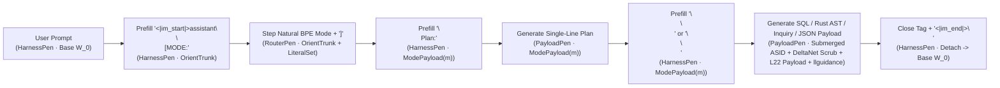

# `Portia` Architecture & Weight-Space Exploits

> *"A tactical retreat from understanding, falling back to more defensible ground instead of risking a total rout."*

This document provides the systems and mathematical reference for **`Portia`**:
1. **The $H = 0 \perp H > 0$ Single-Pen Boundary & Multi-Crate Rust Architecture**
2. **Systems & Mathematical Derivations of the 5 Weight-Space Exploits**
3. **The Unified Non-Overlapping `M + 128` (`3584 -> 3712`) Cartridge Address Map**
4. **Commuting Homomorphism Squares (`RegimeExpr -> IntentExpr`, `PocketObsState -> Steward Coalgebra`)**

---

## 1. The $H = 0 \perp H > 0$ Single-Pen Architecture

A multi-turn database agent interleaves two fundamentally different classes of computation:
- **Zero-Entropy ($H = 0\text{ bit}$) Deterministic Transitions (Handled by Rust `HarnessPen`):** ChatML turn framing (`<|im_start|>assistant\n<think>\n[MODE:`), post-mode plan headers (`]\nPlan:`), route tag dispatch (`</think>\n<sql>\n` vs. `</think>\n<to_user>\n`), SQL lexical syntax and probed schema column membership (`PRAGMA table_info`), read-only query isolation (`PRAGMA query_only = ON`), and pre-write provenance (`SAVEPOINT` row-count limits + `preupdate_hook` mutation tracking).
- **Positive-Entropy ($H > 0\text{ bit}$) Epistemic & Semantic Forks (Handled by Neural `RouterPen` / `PayloadPen`):** Choosing the operational mode at `[MODE:` (`PROBE`, `READ`, `ASK`, `WRITE`, `RESULT`, `ABSTAIN`) over Qwen3.5's natural BPE mode tokens (`" PRO"`, `" READ"`, `" ASK"`, `" WRITE"`, `" RESULT"`, `" AB"`), summarizing the single-line turn plan, binding natural-language or multilingual phrases to schema columns and predicates, and adopting human reviewer (`Steward`) overrides across turns.

In [`crates/portia-core/src/relay/mod.rs`](../crates/portia-core/src/relay/mod.rs), the compile-time typestate chain (`TurnAtOpenPrefill` $\to$ `TurnAtRouterDecision` $\to$ `TurnAtPostModePrefill` $\to$ `TurnAtPlanBody` $\to$ `TurnAtPostPlanPrefill` $\to$ `TurnAtPayloadBody` $\to$ `CompletedRelayTurn`) enforces the **Single-Pen Law** (only one controller writes to the token stream at any step $t$):

$$\forall t,\quad |\text{ActivePen}(t)| = 1, \qquad \text{ActivePen}(t) \in \{\text{HarnessPen}, \text{RouterPen}, \text{PayloadPen}\}$$

### Live Multi-Turn `portia-cli` + `StdioQwenWorker` Runtime

[`crates/portia-cli/`](../crates/portia-cli/src/main.rs) + [`scripts/portia_qwen_stdio_worker.py`](../scripts/portia_qwen_stdio_worker.py) (`PyTorch + llguidance`) drive full token-by-token multi-turn autoregressive sessions through a single OODA coroutine loop ([`worker.rs`](../crates/portia-cli/src/worker/mod.rs)) against prompt-blind `EpistemicDomainEnv` backends: real SQLite databases ([`LiveSqliteDailyDriver`](../crates/portia-cli/src/driver/mod.rs) enforcing `PRAGMA query_only = ON`, monotonic `StewardAuthState` governance, `preupdate_hook` mutation tracking, and `SAVEPOINT` row-count limits) and cleanroom Rust AST typed-hole workspaces ([`LiveRustAstDailyDriver`](../crates/portia-cli/src/rust_driver.rs)). `portia-cli` communicates with the Python stdio worker over a typed two-phase JSON-RPC pipe (`reset_session`, `begin_task`, `prefill`, `sample_token`, `consume_token`, `extract_compiler_weight_geometry`, `capture_payload_activations`, `capture_and_generate_on_policy_plan`), dynamically bank-switching [`WireCartridgeManifestJson`](../crates/portia-compiler/src/wire.rs) slots (`OrientTrunk`, `ModePlan:<Mode>`, `ModePayload:<Mode>`, `Prefill:<Seg>`) and `llguidance` `GrammarCartridgeSpec`s while preserving the model's 18 `GatedDeltaNet` recurrent fast-weight states and 6 GQA `KV` caches across turns.

### Solver & Geometry Guarantees in [`crates/portia-compiler`](../crates/portia-compiler/src/lib.rs)

1. **Separated Pre-MLP (`on_cursor_pre_mlp`) vs. Un-Normalized Residual (`pos_residuals`) Geometry ([`lowering/tables.rs`](../crates/portia-compiler/src/lowering/tables.rs), [`numerics/mod.rs`](../crates/portia-compiler/src/numerics/mod.rs)):**
   In `Qwen3.5`, the pre-MLP `post_attention_layernorm` scales hidden states by $1 + \mathbf{w}_{\text{norm}}$, creating a $\sim 7.25\times$ norm difference between the layer-normalized MLP input $\mathbf{x}_t = \operatorname{RMSNorm}_{\text{post\_attn}}(\mathbf{h}_t^{\text{mid}})$ and the un-normalized residual stream $\mathbf{h}_t^{\text{mid}}$. [`RuleCaptureData`](../crates/portia-compiler/src/lowering/tables.rs) keeps `on_cursor_pre_mlp` / `off_cursor_pre_mlp` separate from `pos_residuals` so gate/up cones are solved in pre-MLP space while $\operatorname{SO}(d)$ chordal radii are calibrated directly on residual norms.
2. **`Clarabel` Conic SOCP/QP Gate-Up Diodes with `AlphaEdit` Preservation & `half::bf16` Verification ([`solvers/conic_qp.rs`](../crates/portia-compiler/src/solvers/conic_qp.rs), [`solvers/clarabel_ternary.rs`](../crates/portia-compiler/src/solvers/clarabel_ternary.rs)):**
   For each compiled SwiGLU slot, $\mathbf{w}_{\text{gate}}, \mathbf{w}_{\text{up}} \in \mathbb{R}^d$ are solved via interior-point convex optimization (`Clarabel` `ZeroConeT`, `NonnegativeConeT`, and `SecondOrderConeT`, with zero backpropagation through the transformer) subject to:
   $$\begin{aligned}
   g_{\text{pos}} - \delta_g \;\le\; \mathbf{X}_{\text{on}} \mathbf{w}_{\text{gate}} &\le g_{\text{pos}} + \delta_g, \\
   \mathbf{X}_{\text{off}} \mathbf{w}_{\text{gate}} &\le g_{\text{neg,ceil}} \mathbf{1} \quad (\le -8.0 \implies \operatorname{SiLU}(g) \approx -0.00268), \\
   \mathbf{Q}_{\text{preserve}}^\top \mathbf{w}_{\text{gate}} &= \mathbf{0}, \quad \|\mathbf{w}_{\text{gate}}\|_2 \le r_{\text{trust}},
   \end{aligned}$$
   followed by immediate round-trip quantization to `half::bf16` and post-quantization verification (`V2CompilerError::InfeasibleDiode` if any row violates the post-`bf16` bound).
3. **Reference-State Coupled 2-Slot $\operatorname{SO}(d)$ Stiefel Frame Calibration ([`numerics/sod.rs`](../crates/portia-compiler/src/numerics/sod.rs)):**
   Adding a naive orthogonal impulse $\Delta\mathbf{h} = \beta\hat{\mathbf{v}}_\perp$ stretches the reference residual norm from $\|\bar{\mathbf{h}}_0\|_2$ to $\sqrt{\|\bar{\mathbf{h}}_0\|_2^2 + \beta^2}$, compressing the downstream `RMSNorm` denominator and triggering Layer $L_{\text{total}} - 1$ anti-echo suppression. Instead, [`StiefelChordalFrame::construct`](../crates/portia-compiler/src/numerics/sod.rs) calibrates a 2-slot rotation around the positive-class reference centroid $\bar{\mathbf{h}}_0$ by angle $\theta$ in the 2D plane $\operatorname{span}\{\hat{\mathbf{h}}_0, \hat{\mathbf{v}}_\perp\}$ (where $\hat{\mathbf{v}}_\perp$ is projected orthogonal to $\operatorname{span}(\mathbf{Q}_{\text{forbidden}} \cup \{\hat{\mathbf{h}}_0\})$ via `faer` thin SVD):
   $$\Delta\mathbf{h}_{\text{chord}}(\theta) = \|\bar{\mathbf{h}}_0\|_2 \Big((\cos\theta - 1)\hat{\mathbf{h}}_0 + (\sin\theta)\hat{\mathbf{v}}_\perp\Big) \implies \|\bar{\mathbf{h}}_0 + \Delta\mathbf{h}_{\text{chord}}(\theta)\|_2 = \|\bar{\mathbf{h}}_0\|_2.$$

---

## 2. Deep-Dive Derivations of the 5 Weight-Space Exploits

### Exploit 1: Bilinear `SwiGLU` Nuisance Suppression & Convex-Midpoint Ternary Forks (`SignedTernaryFork`)

- **Modules:** [`crates/portia-compiler/src/numerics/subspace.rs`](../crates/portia-compiler/src/numerics/subspace.rs), [`crates/portia-compiler/src/solvers/conic_qp.rs`](../crates/portia-compiler/src/solvers/conic_qp.rs), [`crates/portia-compiler/src/solvers/clarabel_ternary.rs`](../crates/portia-compiler/src/solvers/clarabel_ternary.rs)
- **The Problem:**
  85–92% of the variance in the pre-MLP state $\mathbf{x}_t \in \mathbb{R}^{d}$ at `[MODE:` comes from domain vocabulary and natural language, while ambiguous `ASK` / neutral states often sit near the convex midpoint $\mathbf{x}_0 \approx \frac{1}{2}(\mathbf{x}_+ + \mathbf{x}_-)$ between two opposing execution branches (`+1` vs. `-1`). Any single diode trying to fire $+3.2$ on both $\mathbf{x}_+$ and $\mathbf{x}_-$ while clamping $\mathbf{x}_0 \le -8.0$ is convexly infeasible (`Clarabel` `PrimalInfeasible`), because $\mathbf{w}_{\text{gate}}^\top \mathbf{x}_0 \approx \frac{1}{2}(\mathbf{w}_{\text{gate}}^\top \mathbf{x}_+ + \mathbf{w}_{\text{gate}}^\top \mathbf{x}_-) \ge +3.2$.
- **The Mechanism:**
  1. **Diagonal-`P` Within-Class Covariance Whitening, Orthonormal Row-Space Reduction (`w = U z`), & `faer` Thin-SVD Nullspace Projection:**
     `solve_conic_linear_vector` ([`conic_qp.rs`](../crates/portia-compiler/src/solvers/conic_qp.rs)) diagonalizes within-class variance via auxiliary equality variables $\mathbf{y} = \sqrt{\gamma / n_{\text{on}}}(\mathbf{X}_{\text{on}} - \mathbf{1}\bar{\mathbf{x}}^\top)\mathbf{w}$ in `ZeroConeT` (keeping $\mathbf{P}$ 100% diagonal with zero Cholesky fill-in), reduces $\mathbf{w} = \mathbf{U}\mathbf{z}$ onto the active orthonormal constraint row-space ([`conic_subspace.rs`](../crates/portia-compiler/src/solvers/conic_subspace.rs)) whenever $m_{\text{span}} \le \frac{2}{3}d$, and locks preserved nuisance/continuation directions $\mathbf{Q}_{\text{preserve}}$ (`OrthonormalSubspace::from_row_space_svd`) inside `ZeroConeT`.
  2. **Convex-Feasible 2-Slot Ternary `SwiGLU` (`compile_coupled_ternary_pair`):**
     Instead of fighting convexity on `w_gate`, `SignedTernaryFork` holds `w_gate` open (`+3.2`) across all three on-cursor states `{+1, 0, -1}` (clamping `<= -8.5` only on off-cursor/continuation tokens) and places the 3-state sign fork onto the **linear** `w_up_tan` leg (`+1 -> +1.0`, `0 -> [-tol, +tol]`, `-1 -> -1.0`), solving `60/60` (`100%`) held-out worlds in `2` slots.

---

### Exploit 2: Submerged GQA Pointer Bus ($\ker(\mathbf{W}_V) \cap \ker(\mathbf{W}_{U,\text{top}})$) & Phase-Multiplexed 4-Color `ASID` MMU

- **Modules:** [`crates/portia-compiler/src/discovery/gqa_bus.rs`](../crates/portia-compiler/src/discovery/gqa_bus.rs), [`crates/portia-compiler/src/phase_mmu.rs`](../crates/portia-compiler/src/phase_mmu.rs), [`crates/portia-sql/src/v2_pointer_bridge.rs`](../crates/portia-sql/src/v2_pointer_bridge.rs)
- **The Mathematical Barrier ($\forall\alpha.\, \alpha \to \alpha$ Polymorphic Copy Under Scratchpad Interference):**
  A static late-layer SwiGLU slot cannot directly emit an unseen column identifier $\alpha$ (`t_efe.c_ddd`), because copying an unseen token $\alpha$ from context requires **Attention QK-matching + OV-copying**. Worse, in a flat context window, `<schema>` DDL and `<think>` scratchpad tokens share one untagged key-space—so a speculative wrong column guess in `<think>` hijacks copy heads `40/40` times on gibberish schemas.
- **The Exploit (`4:1` GQA Nullspace Submersion + `75%` RoPE Pass-Through `ASID` Coloring):**
  In `Qwen3.5-0.8B-Base` (`num_q_heads = 8`, `num_kv_heads = 2`, `head_dim = 256`, `rotary_dim = 64`), `W_V` has rank `512` inside `1024-D` (`75%` of query capacity has no value projection):
  1. **Zero-Bleed Submersion (`GqaPointerLayer::build_submerged_forbidden_basis`):**
     Both write-time `W_K` tags and read-time `W_Q` selectors are projected strictly orthogonal to $\operatorname{span}(\mathbf{W}_V \operatorname{diag}(\gamma_{\text{in}}) \cup \mathbf{W}_{U,\text{top}})$, yielding `< 10^{-13}` `f64` (`4.7e-7` `bf16`) perturbation to stored `W_V` values and zero immediate vocabulary echo.
  2. **Position-Invariant `75%` RoPE Pass-Through Highway (`[64..256)`):**
     `Qwen3.5` rotates only `[0..64)` with RoPE; `[64..256)` is 100% position-invariant:
     $$\langle \tilde{\mathbf{q}}_t^{(h)}, \tilde{\mathbf{k}}_s^{(g(h))} \rangle = \underbrace{\langle R(\theta_t)\hat{\mathbf{q}}_{[0:64]}, R(\theta_s)\hat{\mathbf{k}}_{[0:64]} \rangle}_{\text{Positional RoPE Slice (25\%)}} + \underbrace{\langle \hat{\mathbf{q}}_{[64:256]}, \hat{\mathbf{k}}_{[64:256]} \rangle}_{\text{Position-Invariant Pass-Through Highway (75\%)}}.$$
  3. **Deterministic 4-Color `ASID` Phase MMU (`synthesize_joint_kv_4color_codebook`):**
     Using `faer` thin SVD over the submerged joint `W_K` passthrough rows across active KV groups, `phase_mmu.rs` partitions the top-16 right singular vectors into 4 orthogonal segment colors (`AuthoritativeSchema`, `UserPresupposition`, `VerifiedObservation`, `EphemeralScratchpad`) paired with `W_Q_gate` copy-head opening and distractor-head closing—multiplexing 7 phase banks into **2 physical SwiGLU slots** and lifting unseen gibberish-schema `SUM` accuracy from `0/40` to `39/40` (`97.5%`).

---

### Exploit 3: Stratified `sqlite.lark` & Causal `PRAGMA table_info` Grammar Cartridge ($H = 0$, Prompt-Blind by Type Signature)

- **Modules:** [`crates/portia-sql/src/grammar_trie/mod.rs`](../crates/portia-sql/src/grammar_trie/mod.rs), [`crates/portia-sql/src/relational_ast/mod.rs`](../crates/portia-sql/src/relational_ast/mod.rs), [`crates/portia-core/src/domain/mod.rs`](../crates/portia-core/src/domain/mod.rs), [`grammars/upstream/sqlite.lark`](../grammars/upstream/sqlite.lark)
- **The Principle (Explicit Dataflow Isolation / Prompt-Blind Grammar Masking):**
  Once the model's `PayloadPen` enters `<sql>`, SQL keyword syntax and probed column existence are $H = 0$ facts of the SQLite connection (`PRAGMA table_info(<table>)` and `PRAGMA foreign_key_list(<table>)`). Crucially, the grammar automaton's dataflow contract ([`EpistemicSqlGrammarCartridge`](../crates/portia-sql/src/grammar_trie/mod.rs) and `compile_sqlite_lark_grammar_for_schemas`) is:
  $$\text{compile\_epistemic\_span\_grammar} : \text{EpistemicSqlGrammarCartridge} \times \text{Mode} \longrightarrow \text{GrammarCartridgeSpec}$$
  Because the function takes only causal probe/provenance state (`TableSchema` & `ColumnSchema` in [`domain.rs`](../crates/portia-core/src/domain/mod.rs)) and the selected `Mode`—and never receives the user prompt—**it cannot peek at user prompt strings to cheat**. Before any table is probed, `legal_modes()` restricts `ModeLabel` to `[Probe, Ask, Abstain]`; once tables are probed, `Read` and `Write` compile [`grammars/upstream/sqlite.lark`](../grammars/upstream/sqlite.lark) (`";\n</sql>"`) strictly over `probed_schemas` via [`llguidance`](https://github.com/guidance-ai/llguidance) `toktrie` Earley bitmasks while the neural trunk's QK/Payload weights rank which table, column, or predicate to emit.

---

### Exploit 4: Natural BPE Mode Contrast Readouts & Contextual Secant Anti-Echo Discovery

- **Modules:** [`crates/portia-core/src/lib.rs`](../crates/portia-core/src/lib.rs), [`crates/portia-compiler/src/discovery/mod.rs`](../crates/portia-compiler/src/discovery/mod.rs), [`crates/portia-compiler/src/wire.rs`](../crates/portia-compiler/src/wire.rs), [`crates/portia-cli/src/compile/input_specs.rs`](../crates/portia-cli/src/compile/input_specs.rs)
- **The Problem:**
  At `[MODE:`, Qwen3.5's 6 natural-language mode prefixes (`" PRO"` = `5140`, `" READ"` = `18104`, `" AS"` = `5574` for `" ASK"`, `" WRITE"` = `37272`, `" RESULT"` = `27604`, `" AB"` = `13732` for `" ABSTAIN"`) have correlated raw unembedding rows (pairwise cosine up to **`+0.4958`**) and overlap with SQL keywords (`" AS"` = `5574`). Pushing unprojected natural-language token directions at Layer $L_{\text{total}} - 2$ triggers Layer $L_{\text{total}} - 1$'s anti-echo suppressor MLP neurons.
- **The Mechanism (Natural BPE `LiteralSet` + Contextual Secant Suppressor Nullspace):**
  `Portia` leaves `model.embed_tokens.weight` and `lm_head.weight` **100% untouched**:
  1. **Span-Scoped `LiteralSet` at `ModeLabel`:** During `RelayPhase::ModeLabel`, [`RelayMachine::active_span_cartridge`](../crates/portia-core/src/relay/mod.rs) co-mounts `CartridgeBank::OrientTrunk` with `GrammarCartridgeSpec::LiteralSet([" PROBE]", " READ]", " ASK]", " WRITE]", " RESULT]", " ABSTAIN]"])` (filtered by `PayloadGrammarAutomaton::legal_modes`), restricting Token 0 to the 6 natural BPE prefixes (`5140`, `18104`, `5574`, `37272`, `27604`, `13732`) and fast-forwarding unambiguous multi-token tails (`"BE]"`, `"K]"`, `"ST"`, `"AIN]"`) up to `]`.
  2. **Constant-Energy Contextual Secant Anti-Echo Discovery (`discover_and_project_anti_echo`):** [`DownstreamSwigluBlock`](../crates/portia-compiler/src/discovery/mod.rs) steps positive residuals along an $\operatorname{SO}(d)$ chord toward the candidate readout $\hat{\mathbf{u}}$, identifies the exact downstream neurons $m$ whose SwiGLU delta opposes $\hat{\mathbf{u}}$ ($\Delta\text{MLP}_m \cdot \hat{\mathbf{u}} < 0$), and projects $\hat{\mathbf{v}}_{\text{target}}$ into the orthogonal complement $\mathbf{I} - \mathbf{Q}_{\text{anti}}\mathbf{Q}_{\text{anti}}^\top$ of their `RMSNorm`-scaled `gate`/`up` input rows before packing into [`WireCartridgeManifestJson`](../crates/portia-compiler/src/wire.rs).

---

### Exploit 5: `Gated DeltaNet-1` `conv1d`-Bypassing Head-Partitioned Scrubber (`in_proj_a` Flush/Lock with `0.000` `in_proj_b` Bleed)

- **Module:** [`crates/portia-compiler/src/solvers/deltanet_scrub.rs`](../crates/portia-compiler/src/solvers/deltanet_scrub.rs)
- **The Problem (Recurrent Fast-Weight Hysteresis & Coupled Scalar-$\beta_t$ Write Pollution):**
  In `Qwen3.5-0.8B-Base`, 18 of the 24 layers (`75%`, including Layers `20, 21, 22`) are **`Qwen3_5GatedDeltaNet`** linear-attention layers maintaining a recurrent fast-weight memory matrix $\mathbf{S}_t^{(h)} \in \mathbb{R}^{128 \times 128}$ per head $h \in \{0..15\}$:
  $$\mathbf{S}_t^{(h)} = \alpha_t^{(h)} \mathbf{S}_{t-1}^{(h)} \left(\mathbf{I} - \beta_t^{(h)} \hat{\mathbf{k}}_t^{(h)} \hat{\mathbf{k}}_t^{(h)\top}\right) + \beta_t^{(h)} \mathbf{v}_t^{(h)} \hat{\mathbf{k}}_t^{(h)\top},$$
  controlled by `in_proj_a.weight` ($\mathbf{W}_a$, retention decay $\alpha_t^{(h)}$) and `in_proj_b.weight` ($\mathbf{W}_b$, coupled erase+write $\beta_t^{(h)}$). Driving $\beta_t^{(h)} \to 1$ on a `</rollback>` token pollutes $\mathbf{S}_t^{(h)}$ with $100\%$ of the noisy boundary value $\mathbf{v}_t^{(h)}$.
- **The Mechanism (`compile_deltanet_head_partition_scrubber`):**
  [`DeltaNetGateLayer`](../crates/portia-compiler/src/solvers/deltanet_scrub.rs) builds the forbidden subspace $\operatorname{span}(\mathbf{W}_{b,\text{eff}} \cup \mathbf{W}_{a,\text{neutral}} \cup \mathbf{W}_{U,\text{top}})$ via `faer` thin SVD and projects the head-partitioned target $+\sum_{h \in \text{flush}} \mathbf{w}_{a,\text{eff}}^{(h)} - \frac{1}{2}\sum_{h \in \text{lock}} \mathbf{w}_{a,\text{eff}}^{(h)}$ strictly out of that basis. A single upstream SwiGLU slot drives $\alpha_{t,h} \to 0$ (`DecayFlush`) on scratchpad heads and $\alpha_{t,h} \to 1$ (`RetentionLock`) on schema/task heads while guaranteeing **`max_beta_crosstalk == 0.000`** across all 16 `in_proj_b` rows.

---

## 3. Unified Non-Overlapping `M + 128` (`3584 -> 3712`) Cartridge Address Map

Static and dynamic slots are allocated into a single non-overlapping address map ([`artifacts/portia_v3_unified_cartridge.json`](../artifacts/portia_v3_unified_cartridge.json), allocated via [`ir/regalloc.rs`](../crates/portia-compiler/src/ir/regalloc.rs) and verified via [`wire.rs`](../crates/portia-compiler/src/wire.rs) + [`compile/bisimulation.rs`](../crates/portia-cli/src/compile/bisimulation.rs)):

| Layer | Physical Slot Range (`[lo..hi)`) | Bank / Subsystem | Systems & Mathematical Function |
| :--- | :--- | :--- | :--- |
| **Layer 0 & `lm_head`** | Untouched (`0` added/modified rows) | Base BPE Vocabulary | Natural BPE mode tokens (`5140`, `18104`, `5574`, `37272`, `27604`, `13732`) under `llguidance` `LiteralSet` + contextual secant anti-echo projection. |
| **Layer 14 / 18** (Pre-GQA L15 / L19) | Disjoint `2`-slot pairs | `Prefill:<Seg>` / `ModePlan:<m>` / `ModePayload:<m>` | Submerged $\ker(\mathbf{W}_V) \cap \ker(\mathbf{W}_{U,\text{top}})$ `75%` RoPE pass-through `ASID` tags & `W_Q_gate` copy-head selectors ([`gqa_bus.rs`](../crates/portia-compiler/src/discovery/gqa_bus.rs), [`phase_mmu.rs`](../crates/portia-compiler/src/phase_mmu.rs)). |
| **Layer 20** (Pre-DeltaNet L21) | `1` slot | `DeltaNetRollbackScrub` | Head-partitioned `in_proj_a` `DecayFlush` / `RetentionLock` impulse with `0.000` `in_proj_b` cross-talk ([`deltanet_scrub.rs`](../crates/portia-compiler/src/solvers/deltanet_scrub.rs)). |
| **Layer 22** | `[3584 .. 3584 + S)` | `permanent_static` (`StaticPermanentScope`) | Reserved static-first floor (`permanent_static ∩ dynamic_banks == ∅`) for co-mounted `Garak` static honesty slots ([`v2_concolic.rs`](../crates/portia-garak/src/v2_concolic.rs)). |
| **Layer 22** | `[3584 + S .. 3712)` | `OrientTrunk` & `ModePayload:<Mode>` (`DynamicSpanScope`) | Coupled 2-slot `SO(d)` router & payload diodes (`StanceRoute` & `SignedTernaryFork` in [`clarabel_ternary.rs`](../crates/portia-compiler/src/solvers/clarabel_ternary.rs)). |

---

## 4. Commuting Homomorphism Squares

1. **`RegimeExpr` $\to$ `ScopedIntentProgram<DynamicSpanScope>` ([`crates/portia-core/src/pocket_dsl/mod.rs`](../crates/portia-core/src/pocket_dsl/mod.rs), [`crates/portia-compiler/src/ir/mod.rs`](../crates/portia-compiler/src/ir/mod.rs), & [`crates/portia-compiler/src/lowering/mod.rs`](../crates/portia-compiler/src/lowering/mod.rs)):**
   Specializes epistemic regime specifications (`RegimeExpr`) with respect to static database schema invariants (Futamura 1) and live turn observations (Futamura 2), lowers them into `IntentExpr` conic programs with automatic `high | low` inhibition, and verifies exact forward `bf16` SwiGLU bisimulation ([`compile/bisimulation.rs`](../crates/portia-cli/src/compile/bisimulation.rs)).
2. **`PocketObsState` Monotonic Sub-Lattice & Steward Coalgebra ([`crates/portia-core/src/steward_coalgebra/mod.rs`](../crates/portia-core/src/steward_coalgebra/mod.rs)):**
   Unfolds reference agent trees (`FreeAgentFrame`) via stack-safe hylomorphisms (`expand_and_collapse` in [`crates/portia-core/src/hylo.rs`](../crates/portia-core/src/hylo.rs)) and verifies that Futamura specialization preserves mode routing across all reachable future observation transitions.
